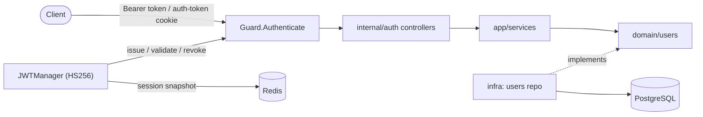
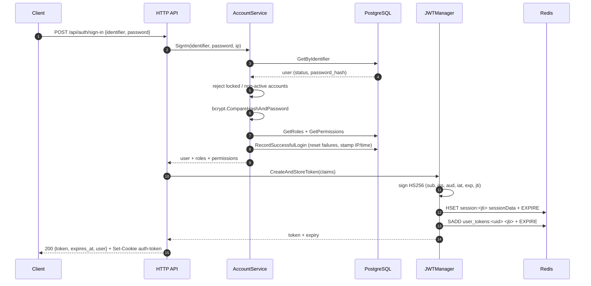

# Authentication Methodology

> How this project proves identity: credentials, JWT tokens and server-side
> sessions. The reference implementation lives in `lib/auth` (reusable engine)
> and `internal/auth` (the auth module).
>
> See also: [Authorization methodology](./authorization.md).

---

## 1. Design Principles

1. **Stateless token + stateful session.** A signed JWT carries the identity
   and a server-side session in Redis makes it revocable. You get JWT speed
   with logout/logout-all/forced-revocation guarantees.
2. **Layered defence.** Credential hashing, account status gates, login
   lockout and session revocation back up the primary authentication gate.
3. **Interface-first completeness.** MFA, OAuth, verification and password
   reset are defined as typed request/response contracts; implementations are
   added without reshaping the API.
4. **Separate library from module.** `lib/auth` is module-agnostic; business
   wiring lives in `internal/auth` (`api → app → domain → infra`, via Uber Fx).

---

## 2. Architecture at a Glance



Key files:

| Concern                                                      | Location                                                    |
| ------------------------------------------------------------ | ----------------------------------------------------------- |
| JWT issue/validate/revoke/sessions                           | `lib/auth/jwt.go`, `lib/auth/session.go`                    |
| `Authenticate` middleware                                    | `lib/auth/middleware.go`                                    |
| Typed auth errors                                            | `lib/auth/errors.go`                                        |
| Sign-in / sign-up use cases                                  | `internal/auth/app/services/accounts.go`                    |
| HTTP controllers                                             | `internal/auth/api/rest/authentication/**`                  |
| Schema (`user`, `account`, `verification`, `password_reset`) | `internal/auth/migrations/20260703212617_init_auth.sql`     |
| Config knobs                                                 | `configs/base/auth.yaml`                                    |
| Frontend scaffold                                            | `packages/ui/src/stores/auth-store.ts`, `hooks/use-auth.ts` |

---

## 3. Credential Model

- Sign-in identifiers: **email, phone, or username** (`GetByIdentifier`
  matches any of the three).
- Passwords are hashed with **bcrypt** (`bcrypt.DefaultCost`); the hash is
  never serialized (`json:"-"`).
- Password policy is defined in `configs/base/auth.yaml` (length, case,
  number, special char) with an enforce helper in `lib/utils/auth.go`.
  Request payloads are validated by GoFrame struct tags; the policy helper is
  ready to be wired into registration/reset flows.

---

## 4. Sign-up Flow

`POST /api/auth/sign-up` → `AccountService.Register`:

1. Validate name + at least one identifier.
2. Check uniqueness of email / phone / username (`Exists`).
3. Hash the password with bcrypt.
4. Insert the user and assign the seeded **`user`** role by slug (looked up,
   not hard-coded — a fresh database without seeds stays safe).

---

## 5. Sign-in Flow



---

## 6. Token & Session Model

JWT claims (`lib/auth/jwt.go`):

| Claim         | Meaning                                            |
| ------------- | -------------------------------------------------- |
| `user_id`     | account UUID                                       |
| `status`      | active / suspended / locked / pending_verification |
| `identifier`  | login identifier used at sign-in                   |
| `role`        | primary role (defaults to `user`)                  |
| `roles`       | all resolved role slugs                            |
| `permissions` | all resolved permission slugs                      |
| `token_id`    | unique token id (jti) — the session key            |
| registered    | iss, sub, aud `api`, iat, exp, id                  |

Configuration (`configs/base/auth.yaml`): HMAC secret key, issuer
(`issure` key in YAML), TTL in minutes (default `1440` = 24h).

Redis keeps two structures per session (`lib/auth/session.go`):

- `session:<jti>` → hash with the session snapshot (user, roles, permissions,
  timestamps), TTL = token TTL.
- `user_tokens:<userID>` → set of the user's token ids, TTL = token TTL.

Why both? The JWT alone can't be revoked; the Redis session can. Token
validation (`ValidateToken`) therefore does **three** checks:

1. Parse + HMAC signature verification (rejects non-HMAC algorithms).
2. `EXISTS session:<jti>` — a token whose session is gone is considered
   revoked/expired.
3. Stored `user_id` must equal the claim — a mismatch fails closed.

---

## 7. Per-Request Authentication

`Guard.Authenticate` extracts the token in one of two ways
(`bearerToken()` in `lib/auth/middleware.go`):

- `Authorization: Bearer <token>` header, or
- `auth-token` cookie (set automatically at sign-in).

On success it stashes `user_id`, `status`, `roles` and `permissions` in the
request context for downstream handlers; on failure it returns **401** with a
typed error (`MISSING_TOKEN`, `INVALID_TOKEN`).

---

## 8. Session Lifecycle Operations

| Operation           | Endpoint                        | Behaviour                                                           |
| ------------------- | ------------------------------- | ------------------------------------------------------------------- |
| Refresh (rotation)  | `POST /api/auth/refresh`        | Validate old → **revoke old** → issue new token + session           |
| Logout (current)    | `POST /api/auth/logout`         | Delete `session:<jti>` and remove from the user's token set         |
| Logout all          | `POST /api/auth/logout-all`     | Iterate `user_tokens:<uid>`, delete every session, drop the mapping |
| List sessions       | `GET /api/auth/sessions`        | Paginated; **the raw token is stripped** from every entry           |
| Revoke one session  | `DELETE /api/auth/sessions/:id` | Ownership-checked: a user cannot revoke somebody else's session     |
| Revoke all sessions | `DELETE /api/auth/sessions`     | Same as logout-all                                                  |

---

## 9. Account States, Lockout & Hardening

Statuses (DB `CHECK` constraint): `active`, `suspended`, `locked`,
`pending_verification`.

- Non-active/locked accounts are rejected **before** the password comparison.
- `RecordFailedLogin` increments a counter and locks the account at the
  threshold (5) with a `CASE WHEN` update; `RecordSuccessfulLogin` resets the
  counter, clears the lock and stamps `last_login_at` / `last_login_ip`.
- The sign-in path records success today; the failed-attempt call is present
  in the repository and left as a deliberate hook in the service.
- Transport & edge hardening: CORS allow-list and global rate limiting live in
  `configs/base/security.yaml`; session cookie flags (`secure`, `http_only`,
  `same_site`) are configurable. Note: the code currently sets the
  `auth-token` cookie directly, so the configured flags apply once the cookie
  flow is finalised.

---

## 10. Planned Flows (Contracted, Not Yet Implemented)

These endpoints exist with full request/response schemas and return
`NotImplemented` until wired:

- **MFA (TOTP)**: challenge with a short-lived challenge token + TOTP/backup
  codes; enable (proves password, returns secret + `otpauth://` URL + hashed
  backup codes); confirm; disable (password + code).
- **Email/phone verification** and resend (generic responses that never
  reveal whether an identifier exists).
- **Password reset**: request code → verify → reset (new password, optional
  revocation of all other sessions).
- **Change password** for the signed-in user (current password required).
- **OAuth/OIDC social login**: google / github / apple / microsoft, with
  `state` CSRF protection, nonce for id_token, and a callback that exchanges
  the provider code for a session (same response shape as sign-in).

---

## 11. Configuration Reference

`configs/base/auth.yaml`:

```yaml
jwt:
  secret_key: "test" # replace per environment
  issure: "random" # issuer claim
  ttl: 1440 # minutes

session:
  provider: redis
  cookie_name: erp_session # session settings (cookie flags, max age)
  max_age: 24h
  secure: true
  http_only: true
  same_site: lax

auth:
  login_path: /auth/login
  logout_path: /auth/logout
  session_timeout: 8h
  password:
    min_length: 8
    require_uppercase: true
    require_lowercase: true
    require_number: true
    require_special_char: true

tenancy:
  enabled: false
  mode: single
```

---

## 12. Current State & Roadmap

**Implemented end-to-end**

- Password authN: sign-up, sign-in, bcrypt, account status gate,
  active/login bookkeeping, identifier-based login.
- JWT + Redis session model: issue, validate, refresh-rotate, logout,
  logout-all, session listing and per-session revocation.
- Route protection with `guard.Authenticate` on account and admin surfaces.

**Contracted, pending implementation**

- MFA (TOTP + backup codes) endpoints.
- Email/phone verification and password reset flows.
- OAuth/OIDC social login.
- Frontend auth store pointed at the real API (currently mock data).

---
