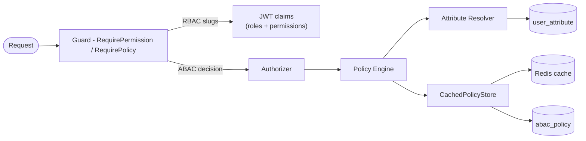
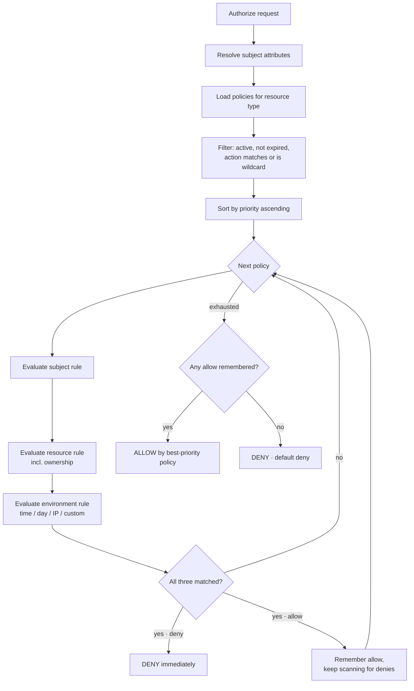

# Authorization Methodology

> How this project decides access: RBAC for coarse-grained control, ABAC for
> fine-grained policy decisions, behind one guard. The engine lives in
> `lib/auth` (`abac.go`, `authz.go`, `middleware.go`); the data model, admin
> APIs and audit trail live in `internal/auth`.
>
> See also: [Authentication methodology](./authentication.md).

---

## 1. Design Principles

1. **Two engines, one guard.** RBAC answers "can this user generally do
   `user.update`?". ABAC answers "may _this_ user update _this_ record, right
   now?". The same `Guard` middleware fronts both.
2. **Deny overrides, default deny.** An explicit `deny` always wins, priority
   breaks ties, and **no matching policy means no access**.
3. **Decisions are explainable.** Every evaluation returns the policy id, the
   reason and evaluation metadata (counts, duration, errors).
4. **Grants are time-bounded.** Role assignments and role-permission grants
   can expire on their own — temporary access needs no cron job.

---

## 2. Architecture at a Glance



Key files:

| Concern                                             | Location                                                |
| --------------------------------------------------- | ------------------------------------------------------- |
| ABAC engine (policies, operators)                   | `lib/auth/abac.go`                                      |
| Authorizer (wires engine to data)                   | `lib/auth/authz.go`                                     |
| Enforcement middleware (Guard)                      | `lib/auth/middleware.go`                                |
| Policy storage + attribute resolver                 | `internal/auth/infra/abac/{store,resolver,cache}.go`    |
| RBAC repositories                                   | `internal/auth/infra/rbac/**`                           |
| Access domain (roles, permissions, policies, audit) | `internal/auth/domain/access/**`                        |
| Schema + seed (roles, permissions)                  | `internal/auth/migrations/20260703212617_init_auth.sql` |
| Admin APIs (RBAC / ABAC / audit / keys)             | `internal/auth/api/rest/{rbac,abac,audit,apikeys}/**`   |

---

## 3. Two Engines, Deliberately

| Layer | Question answered                                  | Mechanism                                       |
| ----- | -------------------------------------------------- | ----------------------------------------------- |
| RBAC  | "Does this user's role grant `user.update`?"       | roles → permissions in PostgreSQL + JWT claims  |
| ABAC  | "May _this_ user update _this_ record, right now?" | policy engine over subject/resource/environment |

RBAC keeps the common case cheap and auditable. ABAC handles ownership, time
windows, IP ranges, attribute comparisons and temporary grants.

---

## 4. RBAC Data Model

```
user ──< user_role >── role ──< role_permission >── permission
                          │            │
                          │            └─ conditions (JSON) + expires_at
                          └─ parent_role_id, level, is_system
```

- Roles are **hierarchical** (`parent_role_id` + `level`) and seeded as
  system roles: `super_admin`, `admin`, `moderator`, `user`, `guest`.
- Permissions are `resource.action` slugs (`user.create`, `role.assign`,
  `audit.export`, …) with a category, `is_system` flag and optional JSON
  `conditions` for ABAC-style refinement.
- Grants can **expire**: both `user_role.expires_at` and
  `role_permission.expires_at` are honoured in the resolution queries.
- `super_admin` bypasses permission checks (`HasPermission` / `HasRole`
  return true), a convention enforced in both `lib/auth` and the domain user.

Permission and role resolution happens **at sign-in** and is embedded in the
JWT; `RequirePermission` then checks the claims (a DB lookup per request is
noted in the code as an option when needed).

---

## 5. ABAC Model

`lib/auth/abac.go` defines the vocabulary:

```go
Subject   {ID, Type, Roles, Attributes}          // who asks
Resource  {Type, ID, OwnerID, Attributes}        // what is asked for
Action    {Name, Resource}                       // what they want to do
Environment {Timestamp, IPAddress, UserAgent, RequestID, Custom} // context
```

A **Policy** targets a resource + action and carries a three-dimensional rule
set:

| Rule dimension | Supports                                                                                      |
| -------------- | --------------------------------------------------------------------------------------------- |
| Subject        | role list, attribute equality/operators, expression hook                                      |
| Resource       | type list, attribute conditions, **ownership check** (`field` in resource vs `subject_field`) |
| Environment    | time windows (timezone-aware, overnight ranges), days of week, IP ranges, custom attributes   |

Attribute comparisons support operators: `$eq`, `$ne`, `$gt`, `$gte`, `$lt`,
`$lte`, `$in`, `$nin`, `$contains`, `$startsWith`, `$regex`. An `expression`
field is reserved as the extension point for CEL.

**Dynamic attributes** for subjects are loaded from `auth.user_attribute`
(`namespace.key`, typed as string / number / boolean / json / date); resource
attributes are supplied by the caller because they are record-specific.

---

## 6. Decision Algorithm



This is the classic **deny-overrides** model with priority ordering
(lower number = higher priority) and **default deny**. Every decision carries
its `PolicyID`, reason and evaluation metadata (policies evaluated/matched,
duration, errors) — useful for logging and for the dry-run `Explain`/`Evaluate`
tooling.

---

## 7. Policy Source & Caching

- `abac.PolicyStore` reads active, non-deleted, unexpired policies from
  `auth.abac_policy`, ordered by priority; **one malformed policy row is
  skipped rather than breaking authorization for everyone**.
- `auth.CachedPolicyStore` wraps the store with a Redis cache
  (`abac:policies:<resourceType>`, TTL 5 minutes) and exposes
  `InvalidateCache` for write-through invalidation.

---

## 8. Enforcement Points

Middleware / Guard API:

| Middleware / method                     | Purpose                                                                |
| --------------------------------------- | ---------------------------------------------------------------------- |
| `Guard.Authenticate`                    | Validate token, load identity into request context, 401 otherwise      |
| `Guard.RequirePermission(slug)`         | RBAC check on a permission slug, 403 `PERMISSION_DENIED` otherwise     |
| `Guard.RequirePolicy(resource, action)` | Full ABAC evaluation with client IP / UA / request id, 403 on deny     |
| `Guard.RequireSingle(slug)`             | Authenticate + enforce exactly one slug                                |
| `Guard.RequireAny(slugs...)`            | Authenticate + enforce at least one of the slugs                       |
| `Guard.ParseClaims`                     | Re-validate and return full claims for custom middleware               |
| `Authorizer.Authorize` / `.Can`         | Programmatic decision for record-level checks inside services/handlers |

Handler-level convenience helpers (read the request auth context):
`BaseController.Can(ctx, permission)`, `.Is(ctx, role)` and
`.HasPolicy(ctx, resourceType, action)`.

`RequirePolicy` cannot see record-level data (the resource isn't loaded), so
handlers guarding a **specific row** call the `Authorizer` directly with
`ResourceID`, `ResourceOwnerID` and resource attributes.

---

## 9. Current Route Protection Map

All routes are mounted under `/api` (`internal/auth/api/rest/**`).

| Group                                        | Middleware                                    | Examples                                                                |
| -------------------------------------------- | --------------------------------------------- | ----------------------------------------------------------------------- |
| `/auth` public subset                        | none                                          | sign-up, sign-in, verification, password recovery, MFA challenge, OAuth |
| `/auth` authenticated subset                 | `guard.Authenticate`                          | refresh, logout, sessions, change password, MFA management              |
| `/account`                                   | `guard.Authenticate`                          | me, profile edits, preferences, linked connections                      |
| `/auth/admin/users`                          | `guard.Authenticate` (+ per-route RBAC ready) | CRUD, ban/unban, role assignment, ABAC attributes                       |
| `/auth/admin/roles`, `/permissions`          | `guard.Authenticate`                          | RBAC administration                                                     |
| `/auth/admin/policies`                       | `guard.Authenticate`                          | ABAC admin + dry-run evaluate                                           |
| `/auth/admin/audit-logs`, `/security-events` | `guard.Authenticate`                          | audit read + event triage                                               |
| `/auth/admin/api-keys`                       | `guard.Authenticate`                          | key lifecycle (hash-only storage)                                       |

The `RequirePermission` / `RequirePolicy` middleware is built and available;
the route groups above currently enforce authentication, and per-route slugs
are applied as endpoints graduate (e.g. permission slug constants already exist
in the controller packages).

---

## 10. Machine Access: API Keys

- Keys are stored as a **prefix + hash**; plaintext is returned exactly once
  (create/rotate) and never recoverable.
- A key can carry its own permission slugs (narrowing the bound role), a rate
  limit, an expiry and a last-used stamp ("touch" from middleware).
- Revocation flips `is_active` and keeps the hash for the audit trail.

---

## 11. Governance: Audit Trail & Security Events

**Audit trail (`audit_log`)** — immutable record of every admin mutation:
actor (user/system/api_key/service), role at the time, action, resource, IP,
user agent, session id, request id, before/after state (JSON), status
(`success`/`failure`/`denied`/`error`) and an optional integrity checksum. The
`auditRecorder` is the **single write path**; audit failures are logged, never
propagated, so a hiccup can't fail a committed mutation.

**Security events (`security_event`)** — a high-priority subset with severity
(`info`/`warning`/`critical`) and a resolve workflow: login success/failure,
logout, lockout, password changes, MFA enable/disable/challenge failures,
permission denied, role changes, suspicious activity, brute-force detection,
token refresh.

---

## 12. Adding a Protected Endpoint (pattern)

```go
// Route registration: authenticate + coarse RBAC.
grp.Middleware(guard.Authenticate).Group("/admin", func(group *ghttp.RouterGroup) {
    group.Middleware(guard.RequirePermission("user.list")).
        Bind(ctlr.GetAllUsers)
})

// Route registration: ABAC for a resource type + action.
group.Middleware(guard.RequirePolicy("document", "update")).
    Bind(ctlr.UpdateDocument)

// Record-level check inside a handler/service (ownership, attributes).
decision, err := az.Authorize(ctx, auth.Request{
    UserID:          userID,
    Action:          "update",
    ResourceType:    "document",
    ResourceID:      doc.ID,
    ResourceOwnerID: doc.OwnerID,
    IP:              r.GetClientIp(),
    UserAgent:       r.Header.Get("User-Agent"),
})
```

---

## 13. Current State & Roadmap

**Implemented end-to-end**

- RBAC administration: roles, permissions, grants and assignments (with
  expiry), hierarchical roles, `super_admin` bypass.
- ABAC engine: policy storage, evaluation middleware, dynamic attribute
  resolver, Redis policy cache, dry-run trace plumbing.
- Audit trail + security events read model, API key read/revoke.
- Route protection with `guard.Authenticate` across account/admin surfaces.

**Contracted, pending implementation**

- Policy CRUD + evaluate endpoints, API key create/rotate/update.
- `RequirePermission` / `RequirePolicy` wiring on every admin route.
- IP-range condition check (present but commented out in the evaluator) and
  the CEL expression hook.
- Per-request DB permission resolution (today permissions are embedded in the
  token at sign-in).

---
